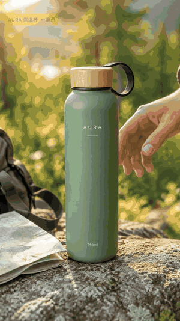
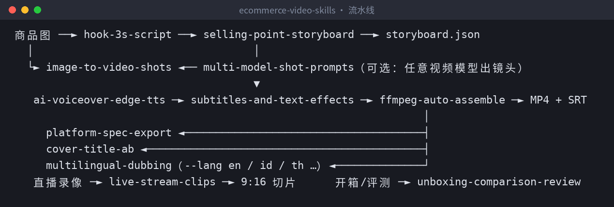
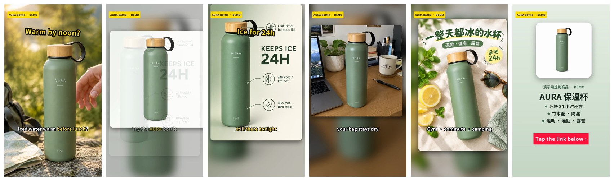
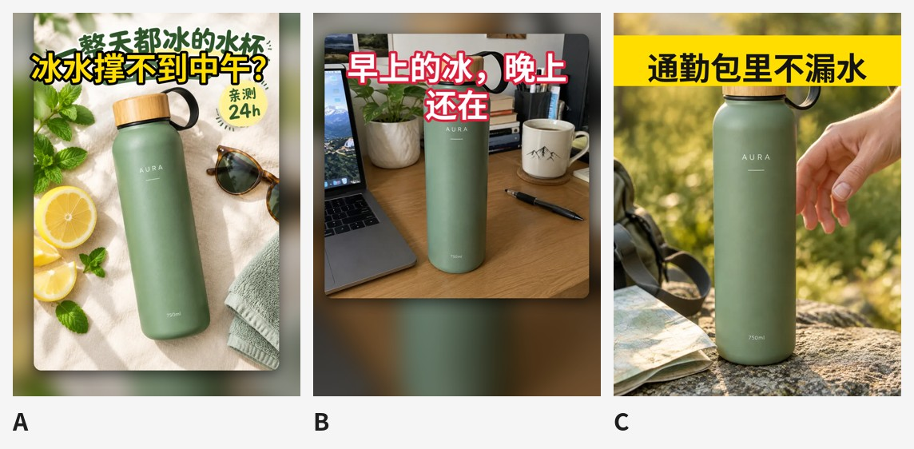

> 在线阅读（GitHub Pages）：https://maynor996.github.io/ecommerce-video-skills/

# 6张商品图→17秒带货短视频：开源12个Claude Skills，配音、字幕花字、BGM本地一条命令出片

## 6张商品图→17秒带货短视频：开源12个Claude Skills，配音、字幕花字、BGM本地一条命令出片

> 一句话介绍：**ecommerce-video-skills** 是一套开源的电商短视频 Agent Skills。丢几张商品图给 Claude Code / Codex / Cursor，它会写钩子和分镜、出多模型镜头提示词，并且**真的在本地用 Python + ffmpeg 把视频剪出来** ——配音、字幕花字、转场、BGM、多平台导出都包含在内。
> 
> 仓库地址：https://github.com/xianyu110/ecommerce-video-skills （MIT 协议）

### 一、痛点：带货视频，卡的不是创意，是流水线

做电商短视频，一条 15 秒的视频要走完：写脚本 → 想前三秒钩子 → 分镜 → 找素材/图生视频 → 配音 → 字幕花字 → 剪辑 → 加 BGM → 按平台导出 → 做封面。

问题在于：

  * **AI 能写脚本，但不会剪片** ：让大模型写分镜很容易，最后还是得自己开剪辑软件一镜一镜拖。
  * **图生视频“很酷但商品变了”** ：瓶身颜色变了、Logo 糊了，带货视频最怕这个。
  * **每个平台尺寸不一样** ：抖音 9:16、小红书 3:4 更占屏、淘宝主图视频 1:1、Amazon 常用 16:9，底部还有商品卡和右侧按钮会挡字幕。
  * **广告法** ：“最好”“第一”“100% 有效”一不小心就写进口播里了。

这个项目的目标是：**把上面这条流水线拆成 Agent 能执行的 12 个步骤，其中剪辑环节用脚本真正跑出成片。**

### 二、项目是什么

核心是一条能跑的本地流水线：

> `storyboard.json` → edge-tts 逐句配音 → Ken Burns 镜头 → xfade 转场 → ASS 字幕/花字 → BGM 自动闪避 → 两遍响度标准化（≈ -14 LUFS）→ MP4 + SRT

纯 Python + ffmpeg，**不需要剪辑软件，剪辑这一步也不需要任何 API Key** （配音用的是免费的 edge-tts）。

和一堆提示词相比，它还做了这些事：

  * 🔒 **商品一致性锁** ：图生视频提示词第一步先锁定形状/颜色/Logo。
  * 🧠 **模型中立** ：同一份分镜适配 Seedance / 可灵 / Veo / Runway / 海螺 / 万相等，**不编造任何模型的价格或参数** ，每个镜头都有本地 Ken Burns 兜底。
  * 📐 **平台规格 + 安全区** ：字幕避开底部商品卡和右侧按钮。
  * 🌏 **出海友好** ：storyboard 加 `line_en` 等字段，`--lang en` 直接渲染英文版。
  * ⚖️ **合规意识** ：钩子/评测模板内置广告法绝对化用语检查、“只写测过的数据”、公平对比规则。

### 三、技能清单（12 个）

Skill| 做什么| 脚本  
---|---|---  
`image-to-video-shots`| 主图转视频：图生视频镜头提示词 + 商品一致性锁 + 本地 Ken Burns 兜底| assemble.py  
`hook-3s-script`| 3 秒钩子：9 种钩子类型一次出 6–10 版（台词+画面+花字），广告法自检| —  
`selling-point-storyboard`| 卖点分镜：15/30/60 秒结构，一镜一信息，输出可渲染的 storyboard.json| —  
`multi-model-shot-prompts`| 多模型镜头提示词：通用骨架 + 运镜词表 + 文生/首帧/首尾帧写法| —  
`ai-voiceover-edge-tts`| AI 口播：edge-tts 逐句合成、去静音、时长统计、缓存| tts_edge.py  
`subtitles-and-text-effects`| 字幕花字：ASS 四种样式（字幕/弹出花字/贴纸/CTA）、关键词高亮、安全区| make_subs.py  
`ffmpeg-auto-assemble`| 一条命令出片：配音、转场、字幕、BGM 闪避、响度标准化| assemble.py 等 5 个  
`platform-spec-export`| 抖音/TikTok Shop/视频号/小红书/淘宝/Amazon 规格导出，安全区预览| export_platform.py  
`live-stream-clips`| 直播切片：时间戳 / 字幕关键词 / 停顿提议三种选段| live_clip.py  
`unboxing-comparison-review`| 开箱/对比评测：结构、拍摄清单、公平对比规则| make_cards.py  
`multilingual-dubbing`| 多语言配音：本地化改写 + 各市场音色 + `--lang` 一键渲染| assemble.py  
`cover-title-ab`| 封面标题 A/B：挑清晰帧/干净底图 + 多标题版式 + 对比图| cover_ab.py  
  
### 四、安装
    
    
    npx skills add xianyu110/ecommerce-video-skills          # 一行安装（skills CLI）
    # 或在 Claude Code 里：/plugin marketplace add xianyu110/ecommerce-video-skills
    

手动安装：
    
    
    git clone https://github.com/xianyu110/ecommerce-video-skills.git && cd ecommerce-video-skills
    mkdir -p ~/.claude/skills && cp -r skills/* ~/.claude/skills/     # Claude Code
    mkdir -p ~/.codex/skills  && cp -r skills/* ~/.codex/skills/      # Codex
    mkdir -p .cursor/skills   && cp -r skills/* .cursor/skills/       # Cursor（项目内）
    pip install -r requirements.txt   # pillow numpy edge-tts；另需自行安装 ffmpeg（含 libass）和中文字体
    

### 五、实战：30 秒跑通仓库自带示例

#### Step 1：看一眼 storyboard.json

示例在 `examples/aura-bottle/`，6 个镜头，每个镜头一张图 + 一句口播。节选前两镜：
    
    
    {
      "voice": "zh-CN-YunxiNeural",
      "rate": "+12%",
      "bgm": "auto",
      "tag": "AURA 保温杯 · 演示",
      "shots": [
        {"image": "assets/lifestyle.webp", "motion": "punch", "transition": "slideup",
         "line": "夏天带冰水出门，不到中午就变温了？",
         "sub": "冰水不到中午就**变温**了？", "title": "冰水撑不到中午？"},
        {"image": "assets/white-bg.webp", "motion": "zoom_in", "transition": "fade",
         "line": "换这只 AURA 保温杯试试。", "sub": "换这只 **AURA** 保温杯试试"}
      ]
    }
    

几个关键字段：`line` 是配音文本（镜头时长 = 配音时长 + 前导 + 留白，**自动对齐** ）；`sub` 里 `**xx**` 是关键词高亮、`|` 是分行；`title` 是弹出花字；`motion` 支持 `zoom_in / zoom_out / pan_* / punch / static`，`punch` 是 0.35 秒快速推近，专门给开场钩子用。

#### Step 2：一条命令出片
    
    
    python scripts/assemble.py examples/aura-bottle/storyboard.json -o out/aura.mp4
    

示例渲染出的成片参数（用 `ffprobe` 实测）：1080×1920、30fps、H.264 + AAC、17.03 秒，同时输出 `.srt` 字幕文件：
    
    
    1
    00:00:00,100 --> 00:00:02,755
    冰水不到中午就变温了？
    
    2
    00:00:02,955 --> 00:00:04,873
    换这只 AURA 保温杯试试
    

想先看节奏不想等配音，可以离线预览：`--tts none`（按字数估时）。

#### Step 3：同一份分镜渲染英文版
    
    
    python scripts/assemble.py examples/aura-bottle/storyboard.json --lang en \
      --voice en-US-AndrewNeural -o out/aura-en.mp4 --build build/en
    

`--lang en` 会读取 `line_en / sub_en / title_en / cta_en` 字段。`multilingual-dubbing` 里还列了美国、英国、印尼、泰国、越南、日韩、墨西哥、巴西等市场的 edge-tts 音色。

#### Step 4：多平台导出 + 安全区检查
    
    
    python scripts/export_platform.py out/aura.mp4 --platform douyin tiktok-shop channels xiaohongshu taobao-main amazon
    python scripts/export_platform.py out/aura.mp4 --safe-preview out/safe.png   # 安全区叠加图
    

比例不同时默认“模糊填充”（`--mode blur`），也可以 `--mode crop` 裁切。导出完会写一份 `export_report.json`，记录每个版本的分辨率、时长、体积。

安全区预览会在一帧上叠加三块经验区域：顶部状态栏约 9%、右侧按钮栏约 15% 宽、底部文案/商品卡约 22%。可以看到字幕和花字都避开了红色区域（这些是经验值，**最终以真机预览为准** ）：

#### Step 5：封面 A/B
    
    
    python scripts/cover_ab.py out/aura.mp4 --images build/still00.png build/still03.png \
      --titles "冰水撑不到中午？|早上的冰，晚上还在"
    

输出 `cover_A.jpg`、`cover_B.jpg`… 和一张对比图 `ab_sheet.jpg`，四种版式轮换（黄字黑描边 / 白字红描边 / 黄底黑字横幅 / 半透明黑底白字）：

一个真实的小教训：A 版的底图本身就带了标题字（来自小红书封面图），新标题叠上去就有点打架。所以 skill 里推荐**优先用不带字幕的干净底图** （`--images build/still*.png`），而不是直接抽成片帧。

### 六、进阶技巧

**1\. 先让 Agent 写钩子，再进分镜**
    
    
    用 hook-3s-script 给这个保温杯写 8 个前三秒开场，标出推荐 Top 3
    

skill 要求每条 ≤ 18 个汉字（3 秒说完）、第一帧必须是商品或痛点（别放 logo 片头）、花字 ≤ 10 字，并且禁用“最、第一、顶级、国家级、100%、根治”等绝对化用语——示例里的“8 小时”“晚上还有冰”也明确标注了：**只有真测过才能用** 。

**2\. 直播录像切高光**
    
    
    # 按字幕关键词找片段，并烧录字幕
    python scripts/live_clip.py live.mp4 --srt live.srt --keywords "演示,对比,上链接,库存" --window 30 --burn-subs
    # 没有字幕：在停顿处切分，输出候选 CSV 再挑
    python scripts/live_clip.py live.mp4 --propose 30 > proposals.csv
    

横屏会自动转成 9:16（模糊背景 + 居中画面）。

**3\. 用你自己有版权的音乐**

`bgm: "auto"` 是 `make_bgm.py` 实时合成的免版权 BGM；想换音乐就 `--bgm music.mp3`。有人声时 BGM 会自动再压低（闪避），最后统一做两遍 loudnorm。

**4\. 想接真正的图生视频模型**

用 `multi-model-shot-prompts` 把同一份分镜改写成不同视频模型的提示词，生成的片段在 storyboard 里用 `video` \+ `start` 字段替换图片即可；没生成好的镜头，Ken Burns 兜底照样能出片。

### 七、没有 Claude / API？

这些 skill 在任何能读 `SKILL.md` 的 Agent 里都能用；本地剪辑脚本**不需要任何 API Key** 。如果你还没有趁手的模型/接口：

  * **方法一 · Claude 国内镜像站** ：`https://claude-opus.top/` —— 打开即用，把 SKILL.md 粘进对话就能按步骤出脚本、分镜和提示词
  * **方法二 · 一站式 API** ：`https://tryallapi.com/register?aff=5A6A` —— 需要在脚本或 Agent 里调模型时，可以把 `https://tryallapi.com/v1` 作为 OpenAI 兼容的 BASE_URL（任何 OpenAI 兼容网关均可）
  * **商品图还没做？** `https://gptimage2.asia/` —— 在线用 GPT Image 2.5 生成主图和场景图，出好图再交给本仓库转成视频

### 八、写在最后

这套 skill 不是要替代剪辑师，而是把“批量出带货视频”里重复、确定的部分自动化：分镜写成 JSON，剪辑交给 ffmpeg，规格和安全区交给脚本，人只需要把关卖点是否真实、成片是否好看。

示例中的「AURA」是 AI 生成的虚构商品，“24h 保冰”等卖点仅作演示。平台规则经常变化，上传前请以各平台官方说明为准。

觉得有帮助的话，欢迎点个 ⭐ Star：

👉 **https://github.com/xianyu110/ecommerce-video-skills**

**姊妹仓库：**

  * 先出图再出视频：电商出图 Skills（本仓库示例视频的素材就来自它）：https://github.com/xianyu110/ecommerce-image-skills
  * 品牌 IP 视觉套件 Skills：https://github.com/xianyu110/brand-ip-kit-skills
  * 国内上线 Skills（ICP 备案 · 支付 · 小程序 · 隐私合规）：https://github.com/xianyu110/golive-china-skills

* * *

我是 MaynorAI 团队，分享 AI 编程、AI SaaS 工具出海、一人团队搭建经验。